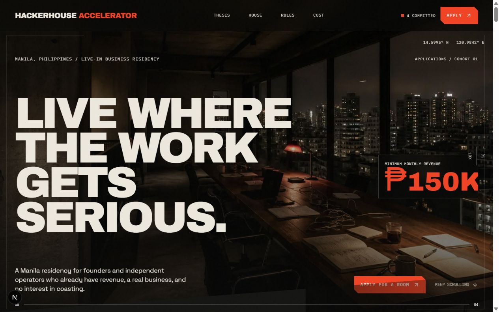

# HackerHouse Accelerator

[](LICENSE)


Marketing site for a live-in business residency: six houses across Metro Manila and Clark,
for founders working full time on one company, whether it already clears PHP 150K/month or
is still pre-revenue, who want to grow one business number tenfold in a year. It is a
**design concept, not an operating business**: house pricing is placeholder, there is no
backend, and the application form posts nowhere unless an endpoint is configured.

Built with Next.js 16 (App Router, Turbopack), React 19, Tailwind v4, and Motion.



<sub>Hero captured during the initial design pass. Some details have since changed.</sub>

## Getting started

```bash
npm install
npm run dev
```

Open http://localhost:3000.

```bash
npm run build   # production build
npm run start   # serve the production build
npm run lint    # eslint
```

There is no test suite.

## Routes

| Route | Source | Content |
| --- | --- | --- |
| `/` | `src/components/HackerHousePage.tsx` | Scroll-driven homepage: growth sequence, filter, proof, houses, rules, cost, FAQ, apply |
| `/thesis` `/rules` `/cost` | `src/components/DetailPage.tsx` | One shared layout rendered from `src/data/pages.ts` |
| `/houses` | `src/components/HouseIndexPage.tsx` | The six-house network with per-house rent and room counts |
| `/houses/[slug]` | `src/components/LocationPage.tsx` | One page per house, from `src/data/houses.ts` |
| `/privacy` `/terms` | `src/components/LegalPage.tsx` | Legal copy from `src/data/legal.ts` |
| `/house` | `next.config.ts` | Permanent redirect to `/houses` (the old single-house page) |
| `/llms.txt` | `src/app/llms.txt/route.ts` | Plain-text summary for language models, generated from the same data |
| `/sitemap.xml` `/robots.txt` `/opengraph-image` | `src/app/` | Generated by Next.js file conventions, along with the icons |

## Structure

```
src/
  app/                  routes, root layout, globals.css, SEO file conventions, llms.txt
  components/           page sections, header/footer, application drawer, cookie notice
  data/
    site.ts             config flags, nav, chapters, copy fragments
    pages.ts            detail-page content + detailMetadata() helper
    houses.ts           the six houses: location, rent, bedrooms (placeholder values)
    faq.ts              FAQ copy, also emitted as FAQPage JSON-LD
    legal.ts            privacy and terms copy
    structured-data.ts  JSON-LD builders (Organization, WebSite, Accommodation, FAQPage, ...)
public/media/           source art (large PNGs, served through next/image)
screenshots/            viewport captures from the design review
docs/superpowers/specs/ design spec for the multi-house network
```

All copy lives in `src/data/`. Editing a headline should not require touching a component.
Design intent and the visual QA record are in [`DESIGN_BRIEF.md`](DESIGN_BRIEF.md) and
[`DESIGN_REVIEW.md`](DESIGN_REVIEW.md).

## Configuration

Set these in `src/data/site.ts`:

| Constant | Purpose | Current |
| --- | --- | --- |
| `SITE_URL` | Canonical origin for metadata, sitemap, robots, JSON-LD and OG images. | Derived from the environment (see below) |
| `APPLICATION_ENDPOINT` | POST target for the application form. Empty means the form falls back to copy-and-send. | Empty |
| `CONTACT_URL` | Direct-message link shown alongside the copy fallback. | Empty |
| `HAS_APPROVED_*` | Gate real imagery vs. code-native placeholders. | Images on, video off |

`SITE_URL` resolves in this order: `NEXT_PUBLIC_SITE_URL`, then Vercel's
`VERCEL_PROJECT_PRODUCTION_URL`, then `VERCEL_URL`, then `http://localhost:3000`. Once there
is a custom domain, set it explicitly:

```bash
NEXT_PUBLIC_SITE_URL=https://your-domain.com
```

### House pricing

Every `rent` and `bedrooms` value in `src/data/houses.ts` is an unconfirmed assumption.
The rest of the site derives its figures from that file, so correcting a number there
updates it everywhere.

### Application form

With `APPLICATION_ENDPOINT` empty, submitting formats the answers into a text block the
applicant copies and sends manually. Set the endpoint to any handler accepting a
`multipart/form-data` POST to collect submissions directly. If you do, revisit
`src/data/legal.ts`: the privacy copy states that nothing is transmitted.

## Media

Source art lives in `public/media/` as large PNGs. They are served through `next/image`,
which is configured in `next.config.ts` to emit AVIF with a WebP fallback, so the
delivered bytes are a fraction of the source files. Keep new art in the same directory
and render it through `next/image`.

## Accessibility and motion

- A skip link, semantic headings, and keyboard-addressable navigation throughout.
- The application drawer traps focus, restores it on close, and is `inert` while closed.
- `@media (prefers-reduced-motion: reduce)` in `globals.css` swaps the scroll-driven
  desktop sequences for the static mobile compositions.

## License

The code is released under the [MIT License](LICENSE). The HackerHouse Accelerator name and
logo identify the project and are not covered by the license.
